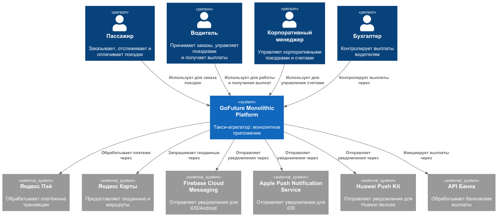
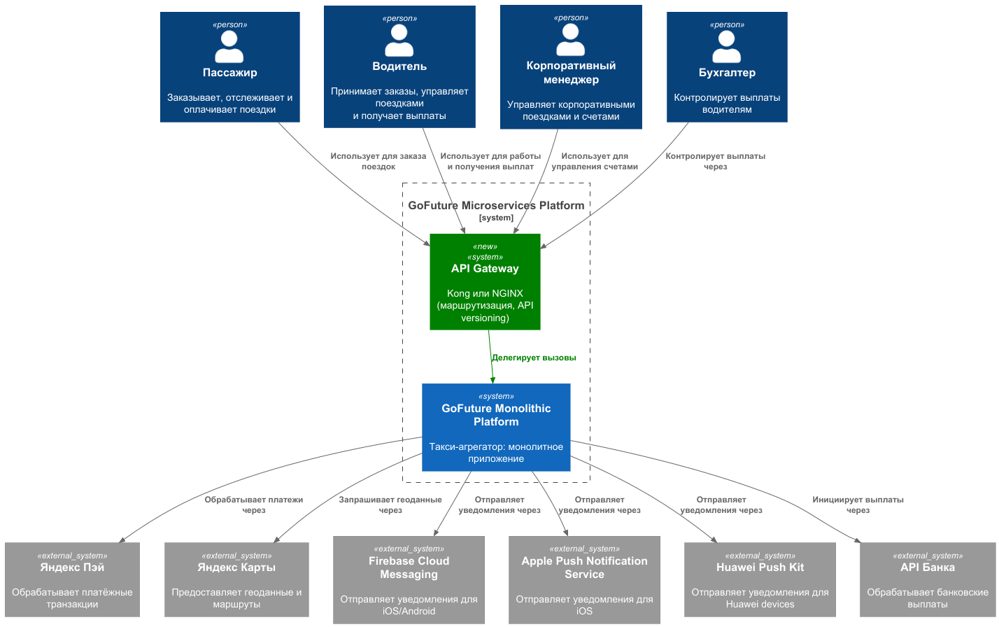
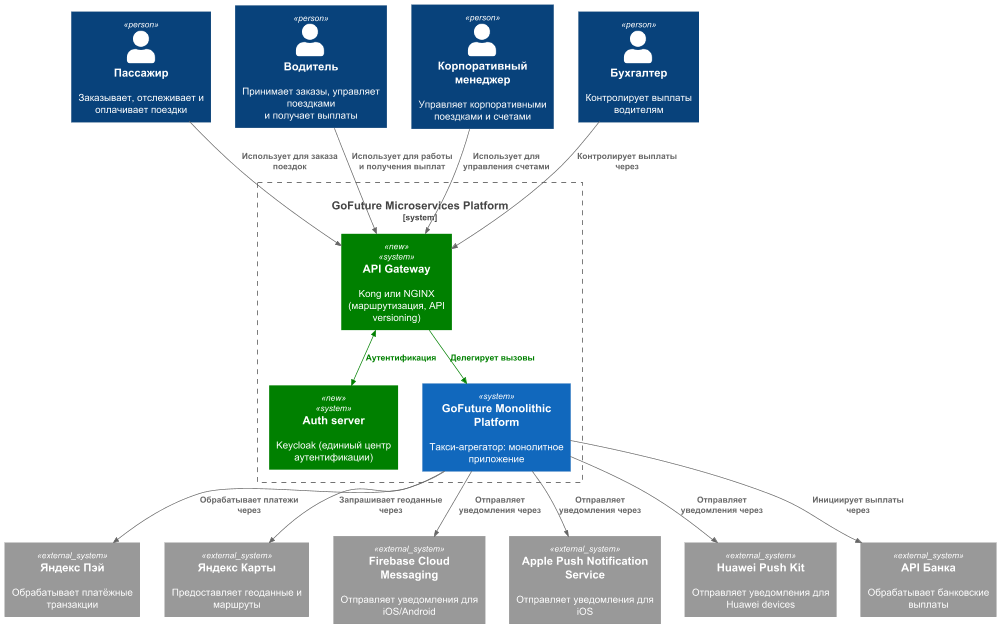
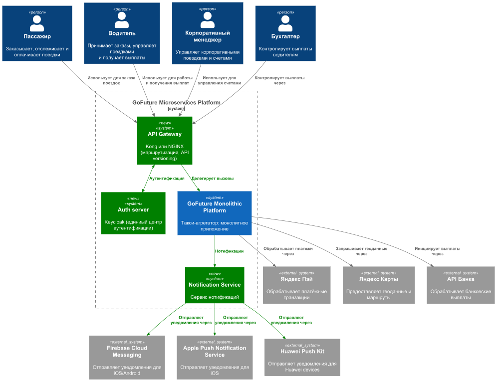
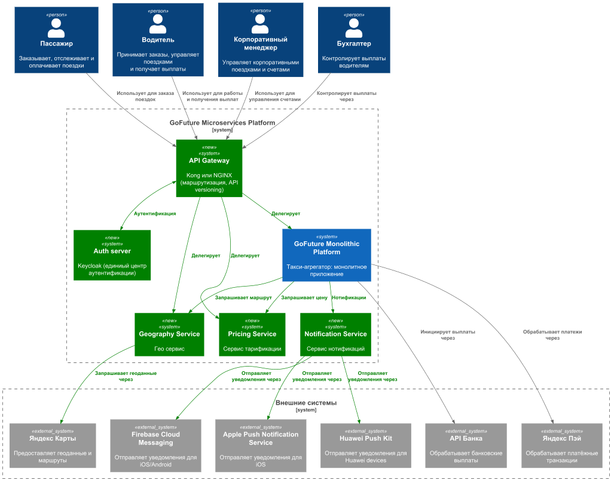
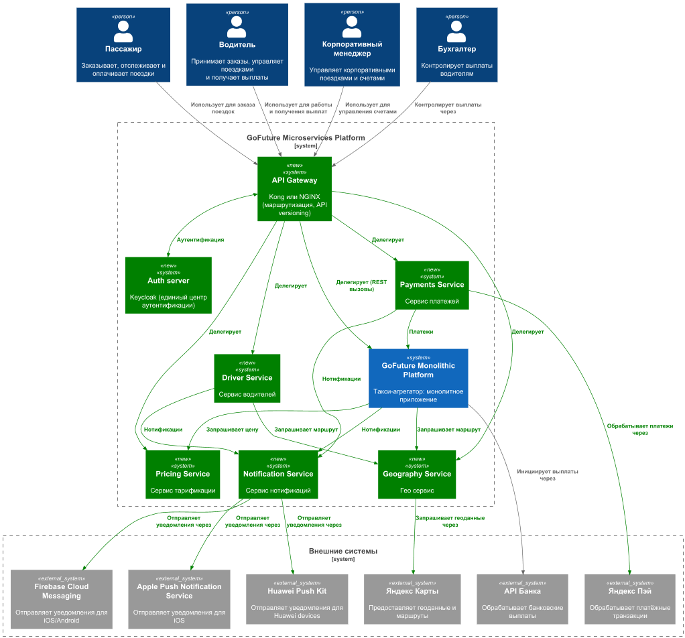
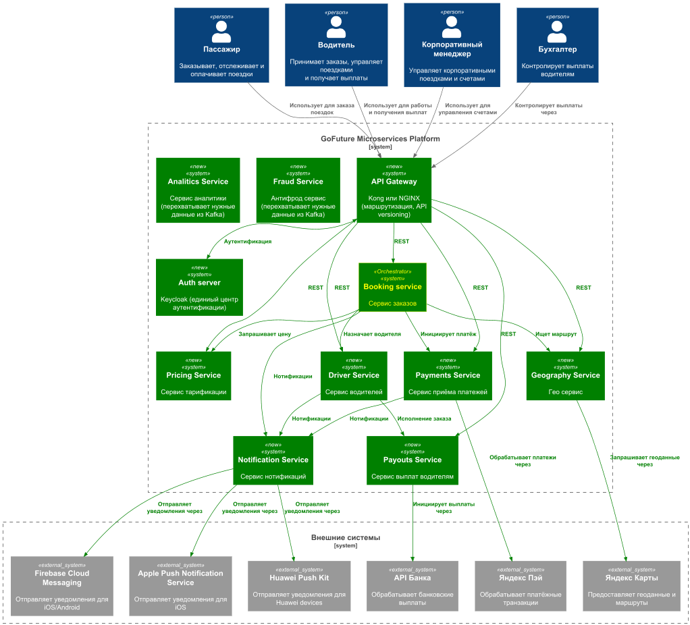
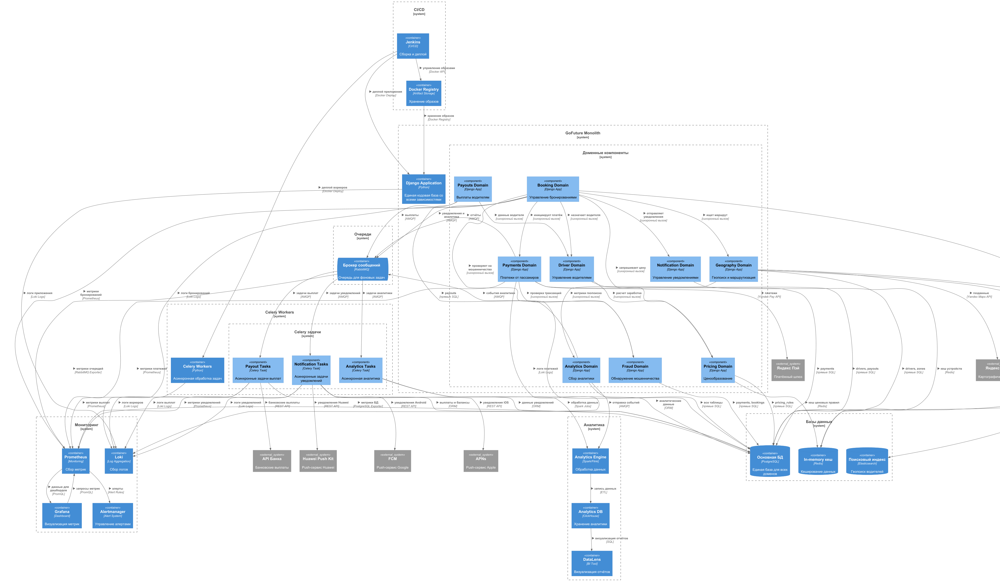
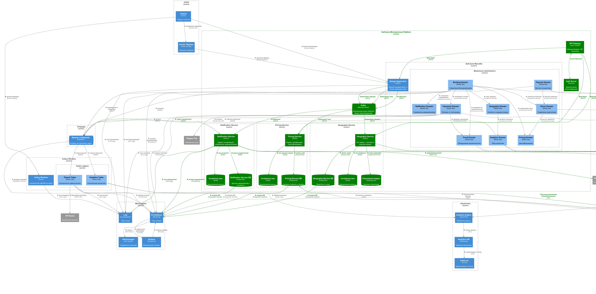
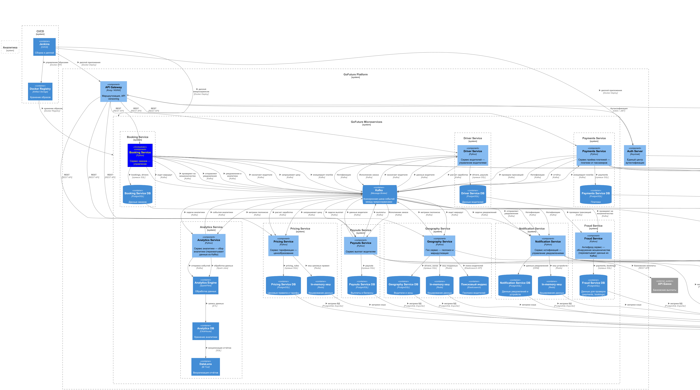

# Шаги миграции #

В данном файле с помощью последовательностей диаграмм показаны шаги миграциии монолита на микросервисы.

Новые элементы схем и новые связи показаны *зелёным цветом*.

Когда появляется сервис-оркестратор, он выделяется *жёлтым шрифтом*.

## Диаграммы C1 ##

### Начальное состояние системы ###

### Шаг 1 - добавление API Gateway ###

### Шаг 2 - добавление сервера аутентификации ###

### Шаг 3 - вынос домена нотификации ###

### Шаги 4-5 - вынос доменов ГЕО и Тарификации ###

### Шаги 6-7 - вынос доменов Водители и Оплаты ###

### Шаги 8-11 - состояние системы после завершения миграции ###

## Диаграммы C3 ##

### Начальное состояние системы ###

### Шаги 1-5 - вынос части доменов ###

### Шаги 6-11 - состояние системы после завершения миграции ###

