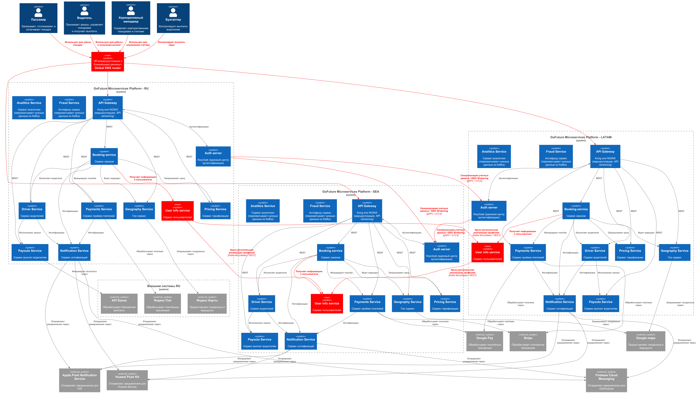

# ADR-03-1: Обеспечение обработки высокой нагрузки и мультирегиональности.

**Статус:** ⚠️ На рассмотрении
**Участники:** Иван Бабиков  
**Дата:** 2026-10-31  

---

## 1. Контекст

От «GoFuture» требуется обеспечить 99.99% доступности и низкую задержку для пользователей в Юго-Восточной Азии и Южной Америке. Это нужно сделать через развёртывание в более чем трёх географических регионах, поэтому создайте дизайн такого глобального развёртывания. Он должен выключать в себя выбор регионов с обоснованием, схему репликации данных между регионами, механизм геомаршрутизации пользователей к ближайшему региону и план аварийного переключения (failover). А также (в качестве дополнительного задания) — стратегию соответствия локальным регуляторным требованиям.

---

## 2. Требования

Исходные требования к системе см. в `Task1\01-ADR.md`.

### Функциональные ###

**FURPS+**:

| Категория | Требование |
|-|-|
| **ФТ-1** | Развернуть систему для работы в Юго-Восточной Азии и Южной Америке. |
| **ФТ-2** | Репликацию пользовательских данных между регионами. |
| **ФТ-3** | Обеспечить определение местоположения пользователей и перенаправление их к системе ближайшего региона. |
| **ФТ-4** | Обеспечить соответствие работы системы согласно региональному законодательству новых регионов. |

### Нефункциональные ###
| Категория | Требование | Критичность |
|-|-|-|
| **НФТ-1** | 99.99% доступность и низкая задержку для пользователей в Юго-Восточной Азии и Южной Америке. | Высокая |

---

## 3. Решение ###

Для обеспечения возможности входа пользователей со своими учетными данными (credentials) при автоматической геомаршрутизации (Global DNS) в ближайший регион выбран **Вариант федеративной аутентификации на базе концепции «Домашнего региона» (Home Region) и OIDC Identity Brokering** (со сценарием валидации токенов по JWKS и OIDC-делегирования):

1. **Концепция домашнего региона (Home Region):**
   - Каждый пользователь регистрируется и хранится в мастер-базе Keycloak и `User info service` своего домашнего региона (региона первоначальной регистрации).
   - В учетной записи пользователя и в клеймах токена явно фиксируется идентификатор домашнего региона (`home_region`).

2. **Аутентификация при входе (Login по credentials в гостевом регионе):**
   - При входе по логину/паролю запрос направляется на региональный Keycloak ближайшего дата-центра (определенного Global DNS).
   - Если пользователь локально не найден в базе регионального Keycloak, сервер аутентификации выступает в роли **Identity Broker (OIDC Identity Brokering)**: через маршрутизацию по префиксу/индексу учетных записей запрос на подтверждение учетных данных делегируется в Keycloak домашнего региона по защищенному каналу (gRPC / mTLS / OIDC).
   * После подтверждения учетных данных гостевой Keycloak выдает пользователю авторизационные токены.

3. **Валидация сессий и токенов (JWKS-верификация):**
   - Все региональные API Gateway и микросервисы доверяют публичным ключам (JWKS) серверов Keycloak всех трех регионов.
   - При наличии активного токена локальный API Gateway гостевого региона валидирует JWT асимметрично на месте, без трансконтинентальных сетевых запросов.

4. **Кросс-региональная синхронизация профиля:**
   - После успешной аутентификации локальный `User info service` гостевого региона выполняет ленивую (lazy-load) репликацию базового профиля пользователя (имя, настройки) из домашнего региона по REST/gRPC или через события Kafka MirrorMaker, кэшируя его на время сессии пользователя в данном регионе.

### Диаграмма решения ###

### Последствия ###

**✅ Положительные:**

1. **Бесшовный роуминг пользователей (Seamless Roaming):** Пользователь может перемещаться между регионами (RU, LATAM, SEA) и входить в систему под своими учетными данными без повторной регистрации.
2. **Строгое соответствие законодательству о персональных данных (Compliance):** Мастер-запись ПДн пользователя не покидает домашний регион, что обеспечивает выполнение требований регуляторов (152-ФЗ в РФ, LGPD в LATAM/Бразилии, GDPR). В гостевых регионах создаются лишь временные сессионные кэш-записи.
3. **Низкая задержка при выполнении бизнес-операций:** Проверка JWT-токенов на API Gateway гостевого региона осуществляется локально по открытым ключам (JWKS) без межконтинентальных вызовов.
4. **Изоляция сбоев (Fault Isolation):** Сбой сервисов или баз данных в одном регионе не приводит к повреждению мастер-данных пользователей в других регионах.

**⚠️ Негативные:**

1. **Усложнение инфраструктуры:** Необходимость настройки и поддержки федерации OIDC Identity Brokering, распределения JWKS и шифрованных межрегиональных каналов (mTLS).
2. **Задержка первичного логина (Login Latency):** При первичном вводе логина/пароля в гостевом регионе время отклика увеличивается из-за трансконтинентального RTT-запроса к Keycloak домашнего региона.
3. **Зависимость первичного входа от домашнего региона:** Если домашний регион пользователя временно недоступен, первичная аутентификация по логину/паролю в гостевом регионе завершится ошибкой (при этом ранее выданные токены продолжат работать).

**↗️ Зависимости:**

1. **Keycloak OIDC Identity Brokering:** Механизм делегирования аутентификации между независимыми региональными инстансами Keycloak.
2. **JWKS (JSON Web Key Sets):** Механизм распределения и ротации публичных ключей для асимметричной локальной проверки JWT на API Gateway.
3. **Kafka MirrorMaker 2 / gRPC:** Инструменты межрегиональной репликации событий и синхронизации кэша профилей пользователей между `User info service`.
4. **mTLS (Mutual TLS):** Безопасный транспортный уровень для шифрования межрегионального трафика между серверами аутентификации.

### 4. Альтернативы

1. **Альтернатива 1: Полносвязная мультимастер-репликация баз данных Keycloak (Active-Active Multi-Region Cluster)**
   * *Описание:* Все инстансы Keycloak используют общую распределенную базу данных (например, CockroachDB / YugabyteDB) или двунаправленную репликацию PostgreSQL, синхронизируя все учетные записи между всеми тремя регионами.
   - *Негативные особенности:*
     * Высокая вероятность конфликтов при одновременном обновлении данных (например, параллельная смена пароля или сброс 2FA) и сложность их разрешения (conflict resolution).
     * Риски нарушения регуляторных требований 152-ФЗ (РФ) или LGPD (Бразилия) из-за физического копирования чувствительных данных пользователей за пределы домашней юрисдикции.
     * Высокая сетевая нагрузка и деградация производительности записи при трансконтинентальной синхронизации.

2. **Альтернатива 2: Централизованный глобальный сервис аутентификации (Global Edge / Anycast Identity Service)**
   - *Описание:* Серверы аутентификации выносятся из региональных периметров в единый глобальный кластер (Edge / Cloudflare Access / Global Auth), куда Global DNS направляет все запросы `/auth`.
   - *Негативные особенности:*
     * Появление единой точки отказа (SPOF) глобального уровня: недоступность глобального auth-контура блокирует вход во всех регионах мира.
     * Потеря автономности региональных контуров: регион не может изолированно функционировать при разрыве внешних каналов связи.
     * Дополнительная сетевая задержка при каждом входе, независимо от региона нахождения пользователя.

### 5. Риски

1. **Риск недоступности домашнего региона при первичном входе (Split-Brain / Region Outage)**  
   *Описание:* При недоступности домашнего региона пользователь, находясь в гостевом регионе, не сможет выполнить первичный вход по логину/паролю.  
   *Меры предотвращения или компенсации:* Использование длительно живущих Refresh-токенов с локальной валидацией на API Gateway; реализация аварийного механизма входа по SMS/OTP через локальный шлюз гостевого региона с последующей отложенной синхронизацией сессии.

2. **Риск задержки отклика (High Latency) при трансграничном OIDC Brokering**  
   *Описание:* Большой сетевой пинг между континентами (например, LATAM и RU) может приводить к тайм-аутам клиентских приложений при аутентификации.  
   *Меры предотвращения или компенсации:* Оптимизация сетевых маршрутов через выделенные облачные каналы (Cloud Interconnect / Direct Connect), настройка агрессивных тайм-аутов и connection pooling для gRPC/mTLS, кэширование открытых ключей JWKS на стороне API Gateway.

3. **Риск рассинхронизации прав доступа и блокировок пользователей (Revocation Latency)**  
   *Описание:* Если пользователь заблокирован в домашнем регионе, гостевой регион может некоторое время продолжать принимать его ранее выданный JWT-токен.  
   *Меры предотвращения или компенсации:* Использование короткоживущих Access-токенов (TTL 5–15 минут), публикация событий отзыва токенов и блокировки пользователей (Token Revocation List / Blacklist) через Kafka MirrorMaker во все регионы в реальном времени.

4. **Риск нарушения регуляторных требований при кэшировании профиля в гостевом регионе**  
   *Описание:* Сохранение профильных данных гражданина в сторонней юрисдикции может нарушать локальные законы о персональных данных.  
   *Меры предотвращения или компенсации:* Кэшировать в гостевом `User info service` исключительно обезличенные технические идентификаторы и минимально необходимые данные (псевдоним, язык интерфейса) с ограниченным TTL (Time-To-Live), не сохраняя паспортные и платежные данные локально в БД гостевого региона.