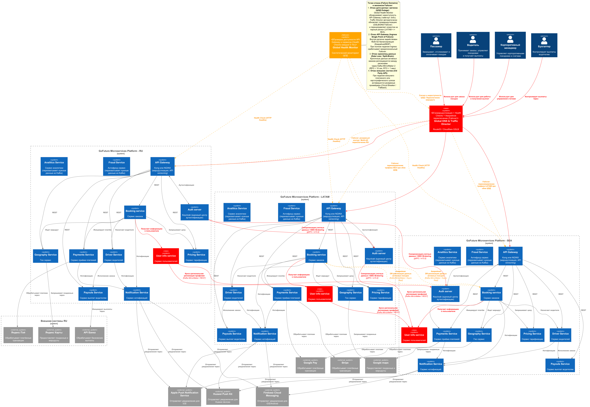

# ADR-03-2: Обеспечение аварийного переключения при глобальных региональных авариях сети.

**Статус:** ⚠️ На рассмотрении
**Участники:** Иван Бабиков  
**Дата:** 2026-10-31  

---

## 1. Контекст

От «GoFuture» требуется реализовать план аварийного переключения (failover)  при глобальных региональных авариях сети.

---

## 2. Требования

Исходные требования к системе см. в `Task1\01-ADR.md`.

### Нефункциональные ###
| Категория | Требование | Критичность |
|-|-|-|
| **НФТ-1** | Иметь в наличии резервные мощности для принятия на себя нагрузки в случае потери работоспособности датацентров в одном из регионов. | Средняя |

---

## 3. Решение ###

Для обеспечения функционирования системы в случае глобальной аварии в одном из регионов предлагается разместить резервные мощности и копии данных в одном или двух дополнительных регионах, либо иметь дополнильные мощности и копии данных в имеющихся регионах. Исходя из ограниченного числа  возможных дополнительных регионов с хорошей сетевой инфраструктурой, предлагаются США или Европа.

Однако из-за наличия на данный момент большого количества ограничений и рисков при размещении данных РФ и РБ в США и Европе в качестве основного решения предлагается второй вариант с размещением резервных мощностей в имеющихся регионах.

### Техническое описание решения:
1. **Глобальный мониторинг и управление трафиком (GSLB & Health Checks):**
   * Компонент `Global Health Monitor` непрерывно проверяет доступность точек входа (`API Gateway`) во всех регионах через эндпоинты `HTTP /healthz` с периодичностью 5–10 секунд.
   * При фиксации серии неудачных проверок (тайм-аут 3x5с) `Global DNS & Traffic Director` (Cloudflare GSLB / Route53) исключает аварийный регион из маршрутизации и автоматически направляет трафик на парный резервный регион (LATAM <-> SEA, для RU — резервный Standby ЦОД).
2. **Аварийная кросс-региональная репликация критических данных (DR Sync):**
   * Состояние активных поездок, назначений и транзакций непрерывно реплицируется между парными регионами через `Kafka MirrorMaker 2` и асинхронную репликацию баз данных. Целевые метрики аварийного восстановления: **RPO < 10 секунд**, **RTO < 1 минута**.
3. **Изоляция сбоев на уровне зависимостей (Circuit Breaker & Fallback):**
   * Бизнес-сервисы защищены паттерном Circuit Breaker: при деградации внешних картографических или платежных сервисов запросы переключаются на резервных провайдеров.

### Таблица сценариев отказа и реакция системы

| Сценарий отказа (Failure Domain) | Детектирование сбоя | Реакция системы (Failover Action) | Ожидаемые RTO / RPO* |
|---|---|---|---|
| **Полный отказ дата-центра / региона (ЦОД Outage)** | `Global Health Monitor` фиксирует недоступность регионального `API Gateway` (3 неудачных probe). | `Global DNS / GSLB` переключает клиентский трафик на резервный дата-центр (LATAM -> SEA, SEA -> LATAM). Резервный регион начинает обслуживать запросы с использованием реплицированных данных. | **RTO:** < 60 сек **RPO:** < 10 сек |
| **Отказ регионального API Gateway (Ingress SPOF)** | Внутренний мониторинг балансировщиков и синтетические внешние проверки. | Локальное автоматическое переключение на резервный узел шлюза через Multi-AZ VRRP(Virtual Router Redundancy Protocol)/Keepalived/BGP Anycast. При невозможности восстановления — эскалация до межрегионального переключения через GSLB. | **RTO:** < 10 сек (локально) / < 60 сек (межрегион) **RPO:** 0 |
| **Сбой / деградация СУБД в регионе (Data Tier Outage)** | База данных не отвечает на запросы сервисов; срабатывает Health Check СУБД. | Локальный промоут синхронной Standby-реплики внутри региона (Patroni / Orchestrator). При катастрофической потере кластера — переключение трафика на резервный регион, где используется последняя DR-реплика данных. | **RTO:** < 30 сек (локальный failover) **RPO:** < 10 сек |
| **Отказ внешнего провайдера (платежи / карты / пуши)** | Circuit Breaker фиксирует превышение порога ошибок (> 50% ответов 5xx или тайм-аутов). | Автоматическое переключение на резервный шлюз (fallback): карты Google Maps -> OpenStreetMap/Here, платежи Stripe -> локальный резервный эквайринг, пуши FCM -> APNs/SMS-шлюз. | **RTO:** < 5 сек (мгновенно) **RPO:** 0 |

*RTO (Recovery Time Objective) и RPO (Recovery Point Objective) 

### Диаграмма решения ###

### Последствия ###

**✅ Положительные:**

1. Предусмотрем режим работы на случай регионального форс-мажора или большой аварии в региональном сегменте интернета.  
2. Кросс-региональное резервное копирование критических данных.

**⚠️ Негативные:**

1. **Усложнение инфраструктуры:** требуется управление дополнительными настройками и периодические ограниченные проверки работоспособности режима failover.
2. **Дополнительные затраты на резервное оборудование**.
3. **На возможность обеспечить наилучшую скорость при работе в режиме failover:** 3 имеющихся региона имеют не самую быструю связь между собой, по сравнению с США или Европой.

**↗️ Зависимости:**

1. **GSLB / Global Anycast DNS (Route53 / Cloudflare):** Внешний распределенный сервис динамического управления трафиком с интегрированными синтетическими проверками доступности (Health Checks).
2. **Kafka MirrorMaker 2:** Механизм кросс-региональной асинхронной репликации критических топиков и событий активных заказов между кластерами Kafka.

### 4. Альтернативы

**Размещение резервных мощностей и копий данных в США или Европе**
*Отклонена:* из-за наличия на данный момент большого количества ограничений и рисков при размещении данных РФ и РБ в США и Европе как со стороны законодательтства РФ, так и санкционных рисков со стороны США и Европы.

### 5. Риски

1. **Риск недостаточной скорости для обеспечения failover между регионами**  
   *Меры предотвращения или компенсации:* 
Использование выделенных межрегиональных каналов (Cloud Interconnect / AWS Direct Connect), агрессивное сжатие трафика репликации (zstd/lz4 в Kafka), приоритизация передачи только критических данных активных поездок и кэширование статических данных на CDN.

2. **Риск Split-Brain (рассогласования состояния при ложном переключении)**  
   *Меры предотвращения или компенсации:* Использование распределенного кворума проверок из нескольких независимых географических локаций перед принятием решения о переключении (не менее 3 probe-локаций); настройка Fencing-механизмов (STONITH) для отключения приема пишущего трафика аварийным регионом при изолировании сети.

3. **Риск перегрузки резервного региона (Cascading Failure / Трамплинный эффект)**  
   *Меры предотвращения или компенсации:* Резервирование как минимум 30–50% избыточных вычислительных мощностей (overprovisioning / Headroom); настройка автоскейлинга (HPA) в резервном кластере Kubernetes; применение адаптивного Rate Limiting и механизма деградации функциональности (shedding некритичного фонового трафика) на API Gateway.

