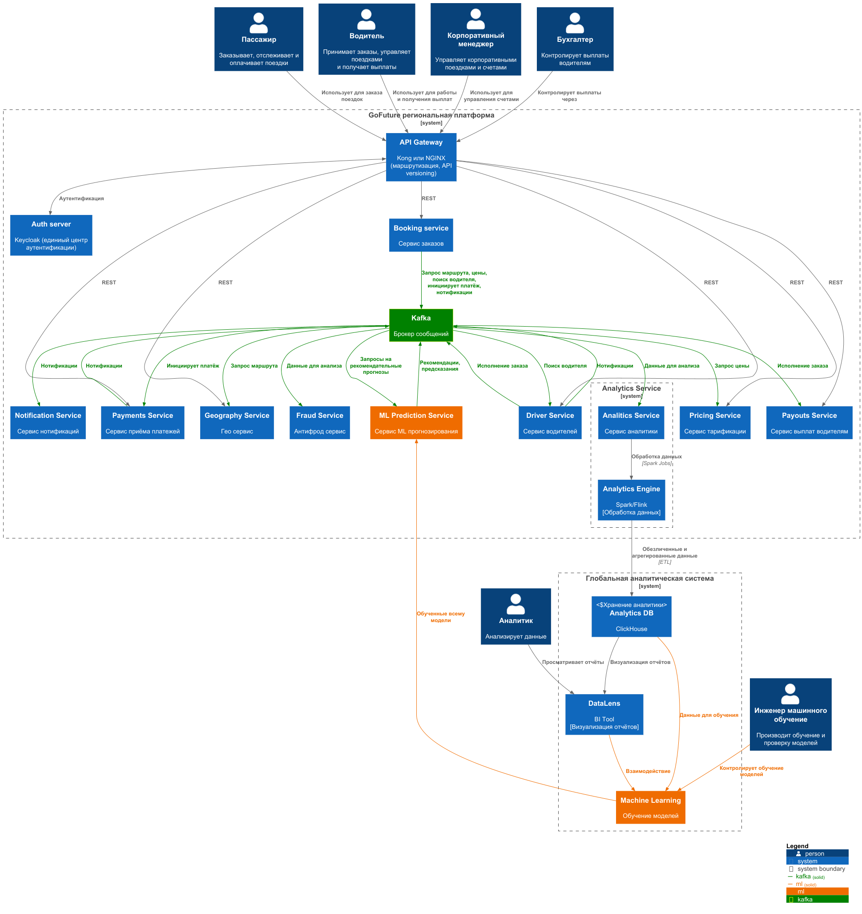

# ADR-04: Спроектировать систему машинного обучения и применение ML при прогнозировании и в анти-фрод.

**Статус:** ⚠️ На рассмотрении
**Участники:** Иван Бабиков  
**Дата:** 2026-11-01  

---

## 1. Контекст

«GoFuture» нужна единая платформа для сбора, обработки и анализа данных для ML-моделей динамического ценообразования, прогнозирования спроса и обнаружения мошенничества. Так что в этом задании требуется создать схему сбора данных из всех микросервисов с интеграцией в ML-платформу и BI-инструменты. В качестве дополнительного задания вы можете описать механизмы обеспечения качества данных.  

---

## 2. Требования

Исходные требования к системе см. в `Task1\01-ADR.md`.

### Функциональные ###

**FURPS+**:

| Категория | Требование |
|-|-|
| **ФТ-1** | Сбор данных из микросервисов. |
| **ФТ-2** | Обучение ML-моделей на накопленных данных. |
| **ФТ-3** | Выдача предсказательных результатов в реальном времени. |
| **ФТ-4** | Экспорт за пределы региона только обезличенных данных. |
| **ФТ-5** | Интеграция ML-моделей с популярными инструментами BI-аналитики. |

---

## 3. Решение ###

**Этапы пайплайна прогнозирования на основе данных**

1. **Analitics Service** перехватывает нужные данные из топиков Kafka.
2. **Analitics Engine** обезличивает и агрегирует данные и пересылает их в глобальную базу аналитики.
3. **Инженер машинного обучения** обучает/дообучает и проверяет модели данных.
4. Проверенные модели отправляются в Prod среду для применения в вычислениях. 

### Диаграмма решения ###

### Механизмы обеспечения качества данных ###

1. Первичные проверки при извлечении данных из Kafka:

- Проверка уникальности по event_id
- Проверка полноты набора событий по SAGA или aggregate_id
- Валидация по типам данных и допустимым диапазонам значений

2. Сверка итоговых сумм в системе аналитики с итоговыми суммами в БД  сервисов - источников данных.

